# Sprint 1 — Arquitectura de red y configuración del router R-G3

**Proyecto:** P0.0 — ASIX 2B, Grupo 3  
**Alumno:** Rubén Mateos Amores  
**Parte del proyecto:** Redes e infraestructura  
**Entorno de trabajo:** Máquinas virtuales en IsardVDI (Ubuntu)

## Índice

1. [Objetivo del sprint](#1-objetivo-del-sprint)
2. [Diagrama y organización de la red](#2-diagrama-y-organización-de-la-red)
3. [Configuración de red del router R-G3](#3-configuración-de-red-del-router-r-g3)
4. [Creación del usuario bchecker](#4-creación-del-usuario-bchecker)
5. [Instalación y activación de SSH](#5-instalación-y-activación-de-ssh)
6. [Activación del reenvío de paquetes](#6-activación-del-reenvío-de-paquetes)
7. [Comprobación de las rutas del router](#7-comprobación-de-las-rutas-del-router)
8. [Configuración de NAT con nftables](#8-configuración-de-nat-con-nftables)
9. [Pruebas desde el cliente Linux](#9-pruebas-desde-el-cliente-linux)
10. [Comprobación del tráfico con tcpdump](#10-comprobación-del-tráfico-con-tcpdump)
11. [Ejemplo de Netplan para un cliente](#11-ejemplo-de-netplan-para-un-cliente)
12. [Resultados y observaciones](#12-resultados-y-observaciones)

---

## 1. Objetivo del sprint

En este primer sprint hemos preparado la base de la infraestructura de red del grupo G3. Mi parte consiste en diseñar la arquitectura y configurar **R-G3** para que los equipos del proyecto puedan utilizarlo como puerta de enlace y salir a Internet mediante NAT.

Para ello, he trabajado con la configuración de las interfaces de red, el usuario de acceso solicitado en la práctica, SSH, el reenvío de paquetes de Linux y las reglas de NAT. Al final he realizado pruebas desde **PC-LIN-G3** y he comprobado el tráfico que pasa por el router.

## 2. Diagrama y organización de la red

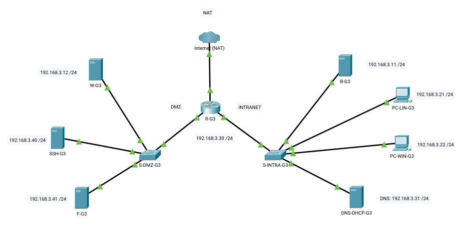

*Figura 1. Diagrama de la infraestructura prevista para el grupo G3.*

En el diagrama hemos organizado los equipos en tres partes: **DMZ**, **intranet** y **salida NAT**. El router **R-G3** conecta las zonas y es el equipo encargado de encaminar el tráfico hacia Internet.

| Zona | Equipos representados | Dirección indicada en el diagrama |
| --- | --- | --- |
| Router | R-G3 | 192.168.3.30/24 |
| DMZ | W-G3 (web) | 192.168.3.12/24 |
| DMZ | SSH-G3 | 192.168.3.40/24 |
| DMZ | F-G3 (FTP) | 192.168.3.41/24 |
| Intranet | B-G3 (base de datos) | 192.168.3.11/24 |
| Intranet | DNS-DHCP-G3 | 192.168.3.31/24 |
| Intranet | PC-LIN-G3 | 192.168.3.21/24 |
| Intranet | PC-WIN-G3 | 192.168.3.22/24 |

La puerta de enlace prevista para las máquinas es **192.168.3.30**, la IP de R-G3 en la red compartida.

> **Nota sobre el diseño:** el diagrama distingue DMZ e intranet de forma lógica, pero las direcciones que aparecen pertenecen todas a `192.168.3.0/24`. Estas capturas no demuestran por sí solas que ambas zonas estén separadas en subredes diferentes. La separación real tendría que comprobarse en la configuración de las interfaces y las redes virtuales.

## 3. Configuración de red del router R-G3

### 3.1. Evitar que cloud-init sobrescriba la configuración

En la máquina virtual comprobé que la interfaz **enp2s0** correspondía a la red compartida que utilizamos para comunicarnos con los demás equipos del grupo. Como la configuración de red estaba gestionada por `cloud-init`, lo desactivé para evitar que regenerase los archivos de Netplan al reiniciar.

```bash
echo 'network: {config: disabled}' | sudo tee /etc/cloud/cloud.cfg.d/99-disable-network-config.cfg
```

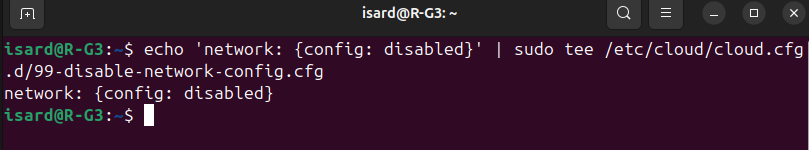

*Figura 2. Creación del archivo que desactiva la gestión automática de red de cloud-init.*

### 3.2. Asignar la IP al router

Después revisé el archivo `/etc/netplan/50-cloud-init.yaml`. En la captura se ve que **enp1s0** obtiene su configuración por DHCP, mientras que **enp2s0** utiliza una dirección estática:

```yaml
network:
  version: 2
  ethernets:
    enp1s0:
      dhcp4: true
    enp2s0:
      dhcp4: false
      addresses:
        - 192.168.3.30/24
```

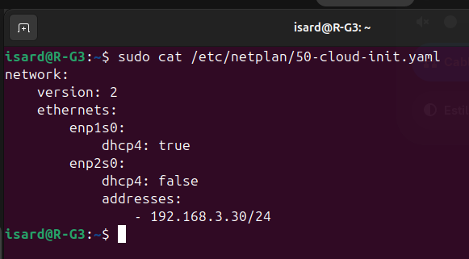

*Figura 3. Configuración de las interfaces de R-G3 mostrada con `cat`.*

De esta manera, la dirección `192.168.3.30` queda reservada para el router dentro de la red del grupo.

### 3.3. Primera prueba de conectividad

Para comprobar la comunicación, hice un ping desde R-G3 al cliente Windows, cuya IP es `192.168.3.22`:

```bash
ping 192.168.3.22
```

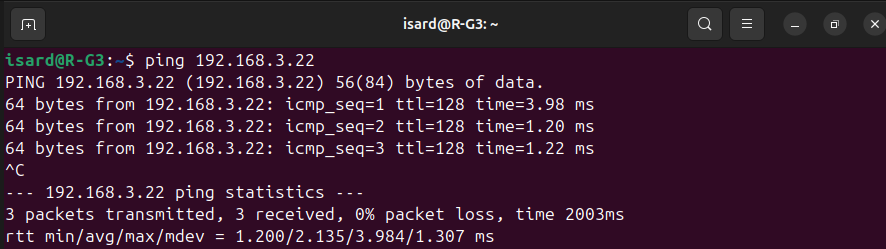

*Figura 4. Respuesta del cliente `192.168.3.22`: tres paquetes recibidos y 0 % de pérdida.*

Esta prueba confirma que el router puede comunicarse con ese cliente en la red del grupo. Todavía no es una prueba de salida a Internet; eso se comprueba más adelante.

## 4. Creación del usuario bchecker

Uno de los requisitos de la práctica es disponer del usuario **bchecker** en los equipos. Lo creé en R-G3 y comprobé que pertenecía al grupo `sudo`, para poder ejecutar tareas de administración.

En la captura aparece el comando de creación del usuario con su contraseña definida mediante `openssl`:

```bash
sudo useradd -m -s /bin/bash -G sudo -p "$(openssl passwd -6 'bchecker121')" bchecker
id bchecker
```

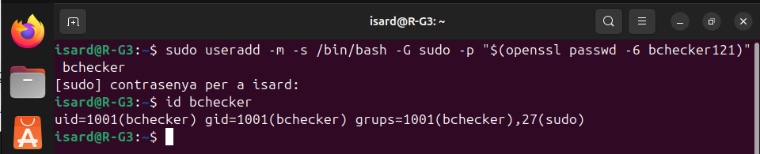

*Figura 5. Creación del usuario y comprobación de su pertenencia al grupo `sudo`.*

A continuación, cambié a esa cuenta para verificar que se podía iniciar sesión correctamente:

```bash
su bchecker
whoami
```

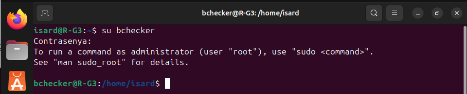

*Figura 6. Acceso a la sesión del usuario `bchecker` en R-G3.*

> La contraseña que aparece en el enunciado se utiliza para esta práctica de clase. En un entorno real no sería recomendable publicar contraseñas ni reutilizar la misma en todos los equipos.

## 5. Instalación y activación de SSH

Para poder administrar R-G3 desde otras máquinas, instalé el servidor OpenSSH:

```bash
sudo apt install -y openssh-server
```

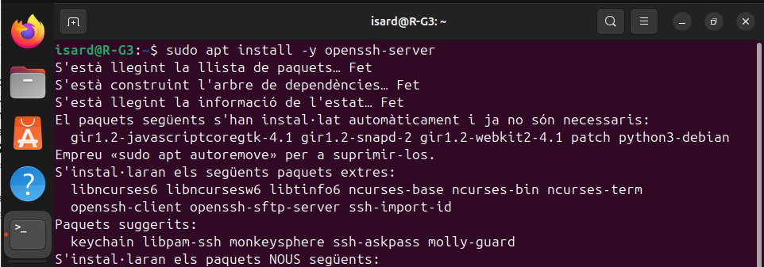

*Figura 7. Instalación del paquete `openssh-server` en el router.*

Después activé el servicio para que se inicie automáticamente cuando arranque la máquina:

```bash
sudo systemctl enable --now ssh
```

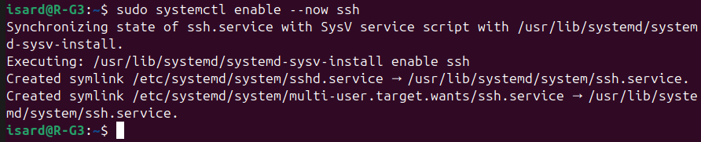

*Figura 8. Activación de SSH mediante `systemctl`.*

Esto deja preparado el acceso remoto por SSH, aunque la captura de esta sección demuestra la instalación y activación del servicio, no una conexión remota concreta a R-G3.

## 6. Activación del reenvío de paquetes

Para que R-G3 funcione como router, Linux debe poder **reenviar paquetes IPv4** entre sus interfaces. Si esta opción está desactivada, el equipo puede comunicarse por sí mismo, pero no actuar como puerta de paso para el tráfico de otros equipos.

Creé una configuración persistente y la apliqué:

```bash
echo 'net.ipv4.ip_forward=1' | sudo tee /etc/sysctl.d/99-router.conf
sudo sysctl --system
```

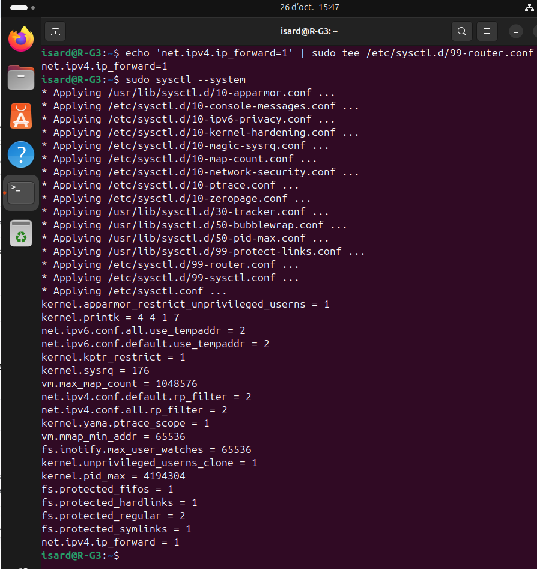

*Figura 9. Aplicación de los parámetros de `sysctl`; en la salida se observa `net.ipv4.ip_forward = 1`.*

Al guardarlo en `/etc/sysctl.d/`, el ajuste se mantiene para los siguientes arranques de la máquina.

## 7. Comprobación de las rutas del router

Una vez preparado el reenvío de paquetes, revisé la tabla de rutas:

```bash
ip route
```

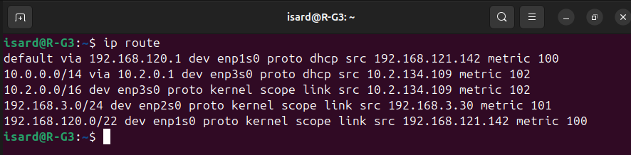

*Figura 10. Tabla de rutas del router, con salida por defecto a través de `enp1s0`.*

La captura muestra que la ruta por defecto utiliza el gateway `192.168.120.1` a través de **enp1s0**. También aparece la red `192.168.3.0/24` asociada a **enp2s0**, con origen `192.168.3.30`.

Esto es importante porque permite distinguir la interfaz que conecta con la red del grupo de la que se utiliza como salida hacia el exterior. En la tabla también aparece otra ruta conectada por `enp3s0`, pero no se documenta una configuración específica de esa interfaz en este sprint.

## 8. Configuración de NAT con nftables

### 8.1. Crear la regla de NAT

Para permitir que los clientes salgan a Internet utilizando el router, configuré **NAT** con `nftables`. La regla utiliza `masquerade`, que sustituye la dirección de origen del tráfico saliente por la dirección de la interfaz de salida.

Abrí el archivo de configuración:

```bash
sudo geany /etc/nftables.conf
```

La configuración que se ve en la captura es la siguiente:

```nft
#!/usr/sbin/nft -f
flush ruleset

table ip nat {
    chain postrouting {
        type nat hook postrouting priority 100; policy accept;
        oifname "enp1s0" masquerade
    }
}
```

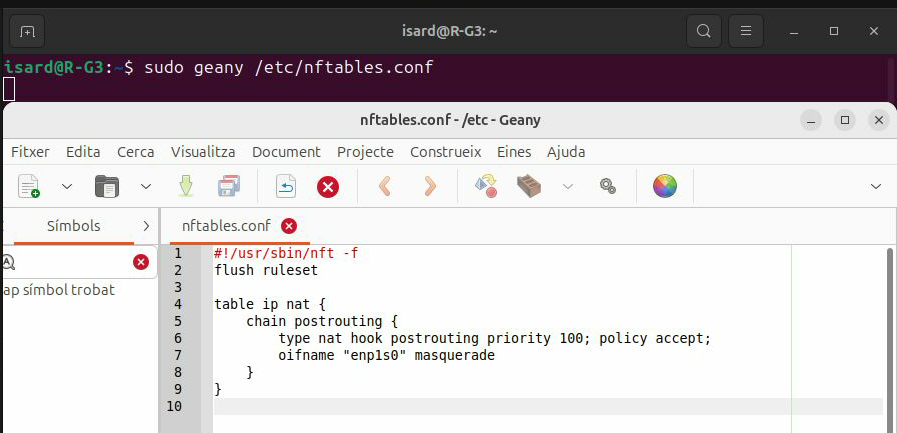

*Figura 11. Archivo `/etc/nftables.conf` con la regla de `masquerade` para `enp1s0`.*

La regla se aplica a los paquetes que salen por `enp1s0`, que es la interfaz de salida indicada en la tabla de rutas. En esta práctica se utiliza para que las máquinas de la red interna puedan comunicarse con destinos externos a través de R-G3.

### 8.2. Instalar y activar nftables

Instalé el paquete correspondiente:

```bash
sudo apt install -y nftables
```

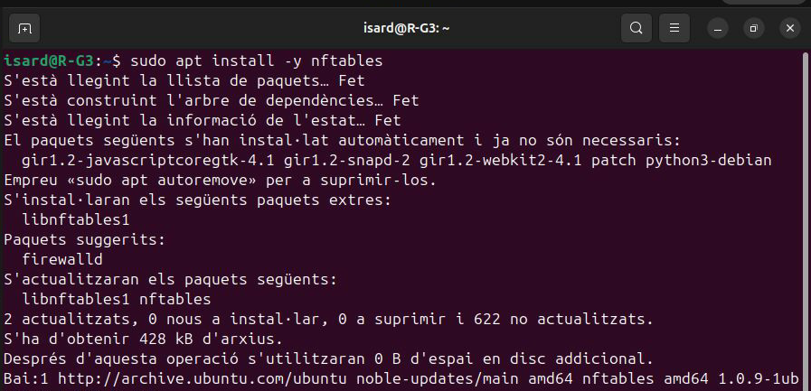

*Figura 12. Instalación del servicio `nftables`.*

Después activé el servicio, validé la sintaxis del archivo y comprobé las reglas cargadas:

```bash
sudo systemctl enable --now nftables
sudo nft -f /etc/nftables.conf
sudo nft list ruleset
```

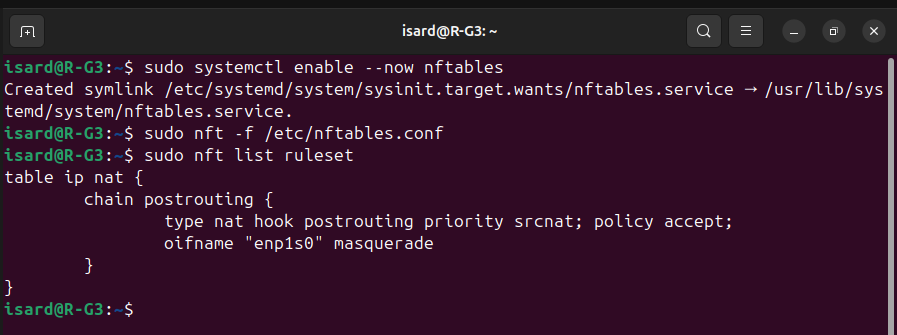

*Figura 13. Comprobación de que la tabla `ip nat` y la regla `masquerade` aparecen en el conjunto de reglas activo.*

Con esto queda configurada la traducción de direcciones. La comprobación completa requiere probar la salida a Internet desde un cliente, como hago en el siguiente apartado.

## 9. Pruebas desde el cliente Linux

Para verificar el funcionamiento del router, me conecté por SSH a **PC-LIN-G3**, que tiene la IP `192.168.3.21`:

```bash
ssh isard@192.168.3.21
```

En el cliente añadí temporalmente una ruta por defecto a través de R-G3 y consulté qué ruta se utilizaría para llegar a una IP pública:

```bash
sudo ip route add default via 192.168.3.30 metric 50
ip route get 8.8.8.8
```

La salida mostrada indica que el tráfico hacia `8.8.8.8` se dirige a través de `192.168.3.30`, usando la dirección de origen `192.168.3.21`.

Después hice las pruebas de conectividad:

```bash
ping 8.8.8.8
ping google.com
```

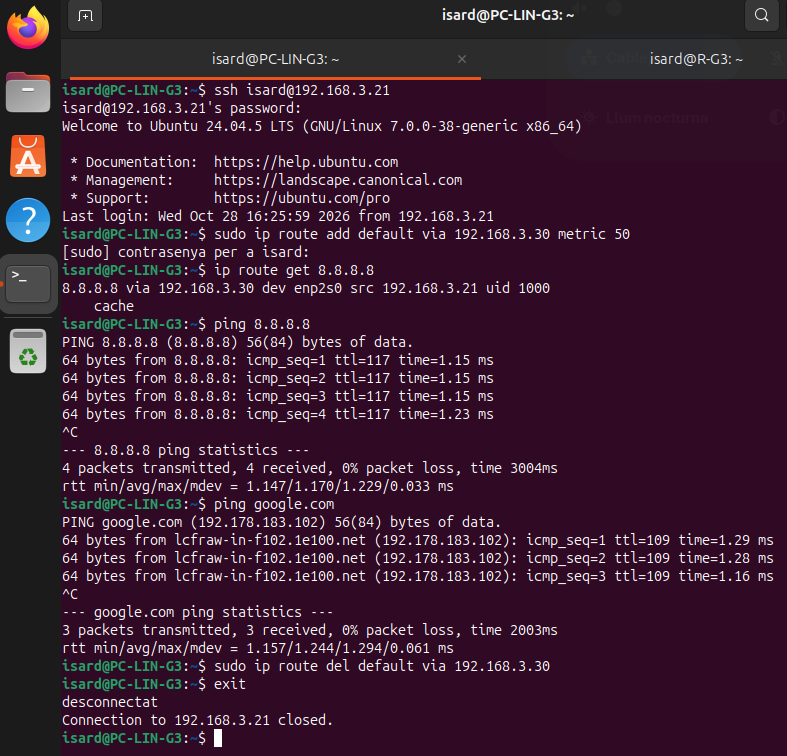

*Figura 14. Ruta por defecto a través de R-G3 y pings correctos a `8.8.8.8` y `google.com`.*

En ambos casos se reciben respuestas sin pérdida de paquetes en las pruebas mostradas. La segunda prueba también indica que el cliente pudo resolver el nombre `google.com` en ese momento. Esto **no significa** que el servicio DNS propio del proyecto estuviera ya configurado.

Al terminar, eliminé la ruta temporal que había añadido:

```bash
sudo ip route del default via 192.168.3.30
```

## 10. Comprobación del tráfico con tcpdump

Además de los pings, quise comprobar directamente en R-G3 que el tráfico del cliente pasaba por el router. Para ello utilicé `tcpdump`, filtrando los paquetes ICMP relacionados con `192.168.3.21`:

```bash
sudo tcpdump -ni any icmp and host 192.168.3.21
```

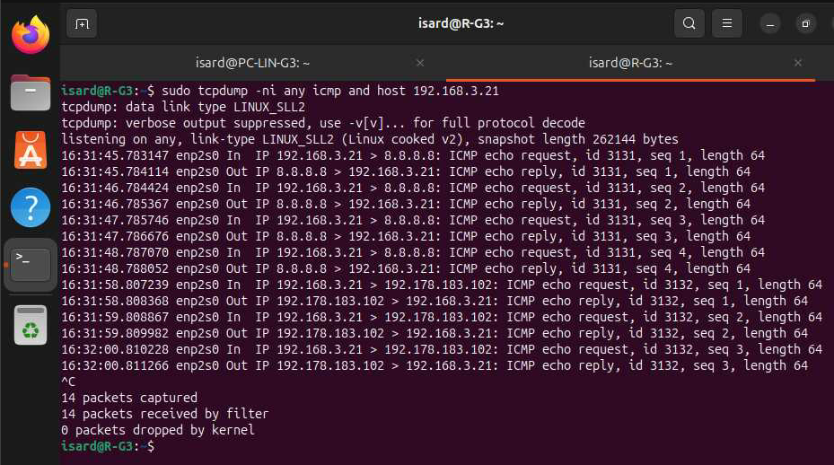

*Figura 15. Captura de paquetes de petición y respuesta ICMP asociados al cliente Linux.*

En la salida se ven peticiones desde `192.168.3.21` hacia `8.8.8.8` y sus respuestas, además de tráfico ICMP relacionado con la prueba a `google.com`. Esta captura es una evidencia adicional de que **R-G3 está procesando el tráfico** del cliente hacia el exterior.

## 11. Ejemplo de Netplan para un cliente

La ruta que añadí con `ip route` durante las pruebas era temporal. Para que un cliente utilice R-G3 como puerta de enlace de manera permanente, la ruta se puede definir en su archivo de Netplan.

En el caso de **PC-LIN-G3**, la captura muestra la IP `192.168.3.21/24`, una ruta por defecto a `192.168.3.30` y los servidores DNS públicos `8.8.8.8` y `1.1.1.1`:

```yaml
network:
  version: 2
  renderer: networkd
  ethernets:
    enp1s0:
      dhcp4: true
      dhcp4-overrides:
        use-routes: false
        use-dns: false
    enp2s0:
      dhcp4: false
      addresses:
        - 192.168.3.21/24
      routes:
        - to: default
          via: 192.168.3.30
      nameservers:
        addresses: [8.8.8.8, 1.1.1.1]
    enp3s0:
      dhcp4: true
      dhcp4-overrides:
        use-routes: false
        use-dns: false
```

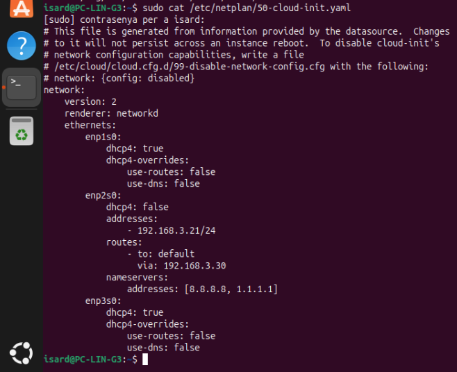

*Figura 16. Configuración de red mostrada en PC-LIN-G3.*

Esta configuración sirve como **ejemplo del cliente Linux documentado**, no como archivo que se pueda copiar sin cambios a todas las máquinas: cada equipo debe utilizar su propia IP y las interfaces que tenga disponibles. En la captura se muestra el contenido del archivo, pero no una ejecución de `netplan apply` ni una prueba posterior al reinicio.

## 12. Resultados y observaciones

Al finalizar este sprint, las capturas aportan evidencias de los siguientes puntos:

- Se ha preparado el diagrama de arquitectura de red del grupo.
- R-G3 utiliza la dirección `192.168.3.30/24` en la interfaz de la red compartida.
- El router se comunica con el cliente Windows mediante ping.
- Se ha creado el usuario `bchecker` y se ha habilitado SSH.
- El reenvío de paquetes IPv4 está activado.
- Se ha configurado y cargado una regla NAT de tipo `masquerade` con `nftables`.
- El cliente Linux puede alcanzar direcciones externas pasando por R-G3 durante las pruebas.
- Se ha observado tráfico ICMP del cliente desde el router mediante `tcpdump`.

**Aspectos que quedan fuera de las pruebas de este documento:** no se muestra una validación completa de la separación efectiva entre DMZ e intranet, ni una comprobación de todas las máquinas tras reiniciar. Los servicios DHCP y DNS del grupo se documentan en el siguiente sprint, no en este.

En conjunto, las pruebas realizadas permiten comprobar que **R-G3 funciona como puerta de enlace con salida NAT para el cliente Linux probado**, que era uno de los objetivos principales de mi parte del Sprint 1.
