# Sprint 2 — Instalación, configuración y pruebas de DNS y DHCP en DNS-DHCP-G3

**Proyecto:** P0.0 — ASIX 2B, Grupo 3  
**Máquina:** DNS-DHCP-G3 (Ubuntu 24.04, IsardVDI)  
**Parte del proyecto:** Servicios de red — DNS con BIND9 y DHCP con ISC DHCP Server  
**Documentación de origen:** capturas de la práctica «Sprint 2 (DHCP y DNS)» del Google Docs del grupo, exportadas a PDF.

> **Alcance de las evidencias.** Este documento describe lo que aparece en las capturas del Sprint 2. Diferenciamos las configuraciones comprobadas de las pruebas todavía pendientes. Las direcciones `192.168.3.21` y `192.168.3.22` que figuran como registros DNS fueron las direcciones **estáticas originales** de los clientes; el cliente Linux obtuvo después `192.168.3.50` mediante DHCP. Los registros DNS de los clientes no se han mostrado actualizados tras esa migración.

## Índice

1. [Objetivo y diseño](#1-objetivo-y-diseño)
2. [Direcciones y servicios utilizados](#2-direcciones-y-servicios-utilizados)
3. [Preparación: usuario bchecker](#3-preparación-usuario-bchecker)
4. [Servidor DNS: instalación y configuración de BIND9](#4-servidor-dns-instalación-y-configuración-de-bind9)
5. [Servidor DNS: validaciones y pruebas](#5-servidor-dns-validaciones-y-pruebas)
6. [Servidor DHCP: instalación y configuración](#6-servidor-dhcp-instalación-y-configuración)
7. [Servidor DHCP: comprobaciones y arranque](#7-servidor-dhcp-comprobaciones-y-arranque)
8. [Pruebas DHCP desde PC-LIN-G3](#8-pruebas-dhcp-desde-pc-lin-g3)
9. [Resultados y comprobaciones pendientes](#9-resultados-y-comprobaciones-pendientes)

---

## 1. Objetivo y diseño

En este sprint hemos preparado **DNS-DHCP-G3** para ofrecer dos servicios a los equipos de la red interna del grupo: la resolución de nombres del dominio `g3.lan` y la asignación automática de direcciones IP mediante DHCP.

Se han instalado **BIND9** para DNS y **`isc-dhcp-server`** para DHCP en la misma máquina. Se mantienen separados sus archivos de configuración y sus puertos: el servidor DNS utiliza el **53/UDP y 53/TCP**, y el servidor DHCP utiliza el **67/UDP**. El DHCP anuncia a los clientes el DNS `192.168.3.31` y la puerta de enlace `192.168.3.30` del router R-G3.

La configuración respeta la arquitectura de red del grupo: ambos servicios atienden a la red compartida de IsardVDI **ITB3**, `192.168.3.0/24`. La división entre intranet y DMZ en el diagrama es organizativa; esta documentación no demuestra aislamiento físico o por subredes entre ellas.

## 2. Direcciones y servicios utilizados

| Elemento | Valor | Función |
| --- | --- | --- |
| Red interna ITB3 | `192.168.3.0/24` | Red de los equipos G3 |
| Máscara | `255.255.255.0` | Máscara de la LAN |
| DNS-DHCP-G3 | `192.168.3.31/24` | Servidor DNS y DHCP |
| Interfaz interna de DNS-DHCP-G3 | `enp2s0` | Interfaz donde atiende DHCP |
| R-G3 | `192.168.3.30` | Gateway de los clientes |
| Dominio DNS | `g3.lan` | Zona directa configurada en BIND9 |
| Pool DHCP | `192.168.3.50`–`192.168.3.59` | Diez direcciones dinámicas |
| DNS que entrega DHCP | `192.168.3.31` | Resolución de nombres de clientes |
| Puerto DNS | TCP/UDP `53` | Consultas y respuestas DNS |
| Puerto DHCP | UDP `67` | Solicitudes del cliente al servidor |

La pool de DHCP se ha reservado fuera de los rangos de direcciones fijas de los servidores, evitando solapamientos con `192.168.3.30` y `192.168.3.31`.

---

## 3. Preparación: usuario bchecker

Antes de configurar los servicios, creamos el usuario de prácticas `bchecker` en **DNS-DHCP-G3**, le asignamos el grupo `sudo` y comprobamos que puede acceder a la sesión. Este usuario permite efectuar tareas de administración cuando sean necesarias.

La captura muestra el comando `useradd`, la comprobación con `id` y, después, el cambio de sesión para verificar la cuenta. La contraseña de prácticas se ha **ocultado en la captura incluida en este paquete** para no publicar credenciales en GitHub.

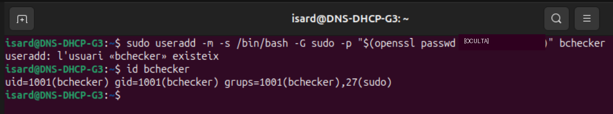

*Figura 1. Alta de `bchecker` y verificación de su pertenencia al grupo de administración.*

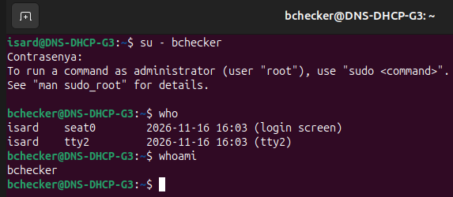

*Figura 2. Prueba de acceso con `su`, `whoami` y comandos de identidad.*

---

## 4. Servidor DNS: instalación y configuración de BIND9

### 4.1. Comprobación de la red y acceso al servidor

Antes de empezar comprobamos la conectividad con **DNS-DHCP-G3** y las direcciones configuradas en sus interfaces. La red interna debe estar asociada a la IP `192.168.3.31/24`, que los clientes utilizarán después como DNS.

```bash
ip -br a
```

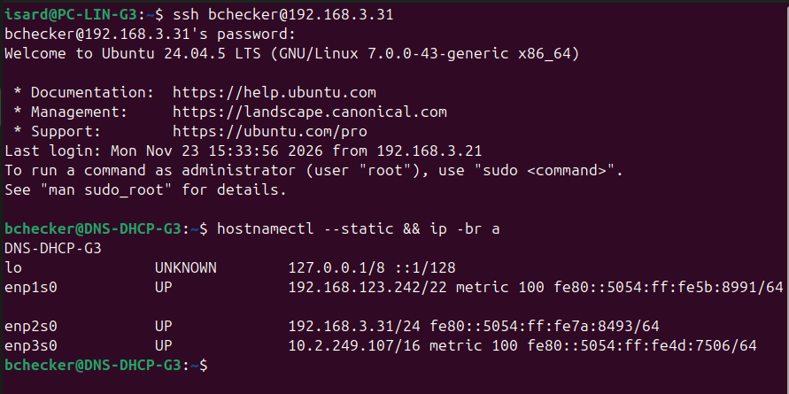

*Figura 3. Acceso al servidor y consulta de interfaces; `enp2s0` presenta la dirección `192.168.3.31/24`.*

### 4.2. Instalación de los paquetes

Actualizamos el índice de paquetes e instalamos **BIND9**, las utilidades de validación y las herramientas de consulta. `bind9` proporciona el servidor; `bind9utils` incluye herramientas de comprobación y `dnsutils` permite realizar consultas como `dig`.

```bash
sudo apt update
sudo apt install -y bind9 bind9utils dnsutils
```

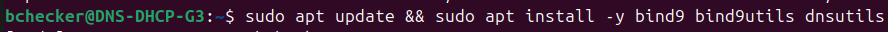

*Figura 4. Comandos de actualización e instalación de los paquetes DNS.*

### 4.3. Copia de seguridad de named.conf.options

Antes de modificar las opciones generales de BIND9 guardamos una copia de seguridad de `/etc/bind/named.conf.options`. De este modo se puede recuperar la versión anterior si se produce un error.

```bash
sudo cp /etc/bind/named.conf.options /etc/bind/named.conf.options.bak
```

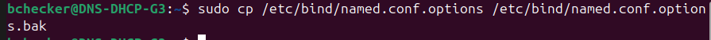

*Figura 5. Copia del fichero de opciones antes de editarlo.*

A continuación, en la práctica se vació el archivo para escribir una configuración nueva:

```bash
sudo truncate -s 0 /etc/bind/named.conf.options
```


*Figura 6. Comando `truncate` aplicado al archivo de opciones. Es importante haber realizado previamente la copia de seguridad.*

### 4.4. Opciones globales de BIND9

En `/etc/bind/named.conf.options` configuramos las direcciones en las que escucha el servidor, el acceso de la red interna, la recursión y los reenviadores para nombres externos.

La captura de la práctica muestra una configuración equivalente a:

```conf
options {
    directory "/var/cache/bind";
    listen-on { 127.0.0.1; 192.168.3.31; };
    listen-on-v6 { none; };
    allow-query { localhost; 192.168.3.0/24; };
    recursion yes;
    allow-recursion { localhost; 192.168.3.0/24; };
    forwarders { 8.8.8.8; 1.1.1.1; };
    dnssec-validation auto;
};
```

**Interpretación:** `listen-on` hace que BIND9 atienda en la IP interna; `allow-query` autoriza consultas desde el propio servidor y la red del grupo; `recursion` permite resolver nombres fuera de `g3.lan`; `forwarders` delega esas consultas a resolutores externos.

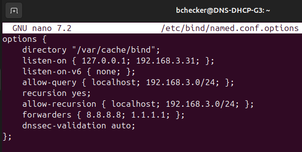

*Figura 7. Opciones de escucha, acceso, recursión y reenviadores del servicio DNS.*

### 4.5. Declaración de la zona g3.lan

La práctica también vació `/etc/bind/named.conf.local` para dejar únicamente la declaración necesaria:

```bash
sudo truncate -s 0 /etc/bind/named.conf.local
```

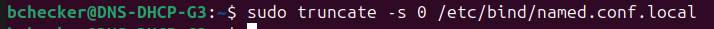

*Figura 8. Preparación del archivo donde se declaran las zonas DNS.*

Declaramos `g3.lan` como **zona maestra** y señalamos el fichero de zona directa que contiene sus registros:

```conf
zone "g3.lan" {
    type master;
    file "/etc/bind/db.g3.lan";
};
```

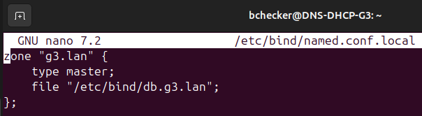

*Figura 9. Zona `g3.lan` declarada como maestra en `named.conf.local`.*

### 4.6. Registros de la zona directa

Creamos `/etc/bind/db.g3.lan` para relacionar nombres de equipos con sus direcciones IP mediante registros **A**. También se incluyen los registros de control **SOA** (inicio de autoridad) y **NS** (servidor de nombres).

La evidencia muestra entradas de este tipo:

```dns
$TTL 86400
@    IN SOA ns1.g3.lan. admin.g3.lan. ( 1 3600 900 604800 86400 )
@    IN NS  ns1.g3.lan.
ns1  IN A   192.168.3.31
R-G3 IN A   192.168.3.30
R    IN A   192.168.3.30
DNS-DHCP-G3 IN A 192.168.3.31
```

En el archivo mostrado también aparecen registros de **B-G3**, **W-G3**, **SSH-G3**, **F-G3**, **PC-LIN-G3** y **PC-WIN-G3** con sus direcciones iniciales de la red. Esta muestra es ilustrativa de las entradas relevantes: la captura conserva el contenido completo.

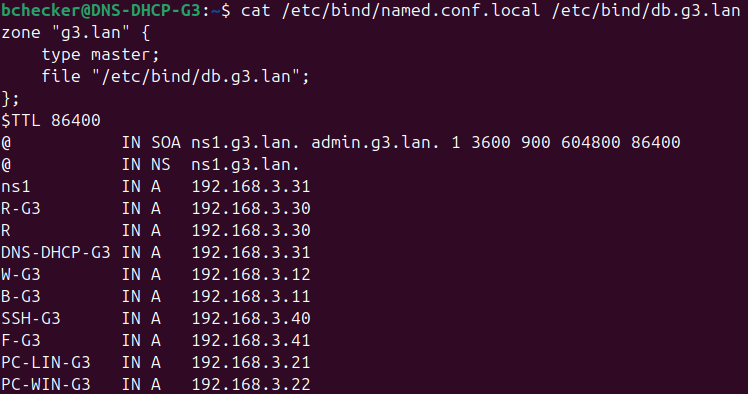

*Figura 10. Consulta del contenido de `named.conf.local` y `db.g3.lan`, con los registros locales del grupo G3.*

> **Atención al cambio a DHCP:** la captura DNS contiene los registros originales `PC-LIN-G3 → 192.168.3.21` y `PC-WIN-G3 → 192.168.3.22`. Posteriormente, PC-LIN-G3 recibe `192.168.3.50` por DHCP. Si se pretende resolver los nombres de los clientes hacia sus IP actuales, será necesario actualizar el registro A correspondiente o implementar actualizaciones dinámicas DNS; el PDF no demuestra que se haya hecho.

---

## 5. Servidor DNS: validaciones y pruebas

### 5.1. Validación sintáctica y carga de la zona

Antes de iniciar el servicio comprobamos la sintaxis de la configuración de BIND9 y que el archivo de zona se pueda cargar.

```bash
sudo named-checkconf
sudo named-checkzone g3.lan /etc/bind/db.g3.lan
```

En la captura `named-checkzone` devuelve **`OK`**, lo que demuestra que el archivo de zona es sintácticamente válido.

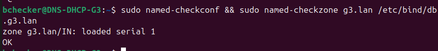

*Figura 11. Comprobación de sintaxis y carga satisfactoria de la zona `g3.lan`.*

### 5.2. Activación y estado de BIND9

Habilitamos y reiniciamos el servicio para cargar la configuración y mantenerlo activo tras un reinicio de la máquina.

```bash
sudo systemctl enable named
sudo systemctl restart named
sudo systemctl status named --no-pager
```

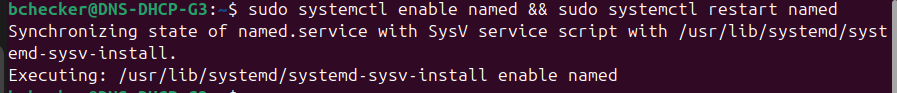

*Figura 12. Activación del servicio BIND9 y reinicio después de editar los archivos.*

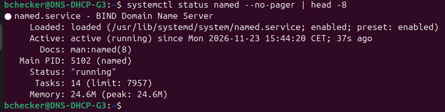

*Figura 13. `systemctl status named` muestra el servidor DNS como **active (running)**.*

### 5.3. Puertos de escucha DNS

Verificamos que el proceso `named` está escuchando en el puerto **53** mediante `ss`:

```bash
sudo ss -tulnp | grep :53
```

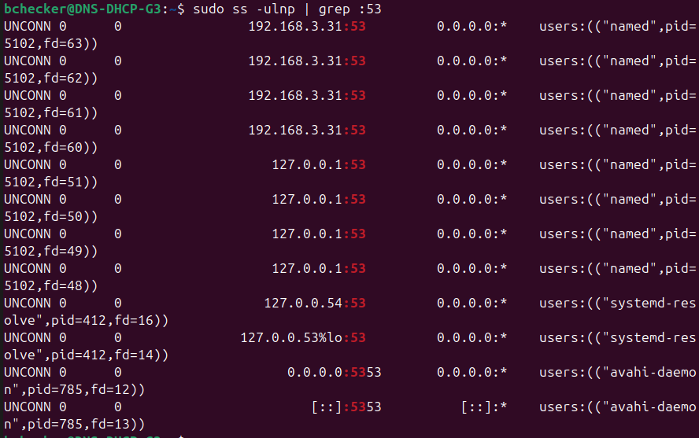

*Figura 14. Sockets de DNS en TCP y UDP; aparece `named` escuchando en `192.168.3.31:53` y `127.0.0.1:53`.*

### 5.4. Resolución de los registros locales desde el servidor

Consultamos explícitamente nuestro servidor `192.168.3.31` con `dig`, primero para el nombre principal del router y después para su alias corto:

```bash
dig @192.168.3.31 R-G3.g3.lan +short
dig @192.168.3.31 R.g3.lan +short
```

Las dos consultas devuelven `192.168.3.30`, la dirección del router R-G3. Esto demuestra que la zona local responde a ambos nombres.

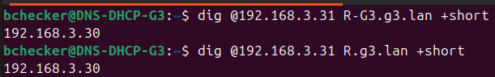

*Figura 15. Resultado `192.168.3.30` para `R-G3.g3.lan` y `R.g3.lan`.*

### 5.5. Resolución de un dominio externo

Para comprobar la recursión o reenvío DNS, consultamos también `google.com` a través del servidor local:

```bash
dig @192.168.3.31 google.com +short
```

La respuesta muestra varias direcciones públicas. Esto confirma que el servidor no se limita a su zona interna y que, en el momento de la prueba, podía resolver dominios externos.

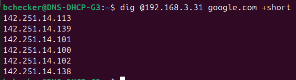

*Figura 16. Resolución de `google.com` a través de `192.168.3.31`.*

### 5.6. Prueba DNS desde PC-LIN-G3

Repetimos las consultas desde el cliente Linux, especificando el DNS interno. Las respuestas vuelven a ser `192.168.3.30`, lo que demuestra que el servicio es accesible desde otra máquina de la red.

```bash
dig @192.168.3.31 R-G3.g3.lan +short
dig @192.168.3.31 R.g3.lan +short
```

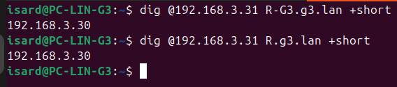

*Figura 17. Consultas DNS satisfactorias desde el cliente Linux a BIND9.*

### 5.7. Prueba DNS desde PC-WIN-G3

En el cliente Windows verificamos la misma resolución con `nslookup` y la IP explícita del servidor DNS:

```powershell
nslookup R-G3.g3.lan 192.168.3.31
nslookup R.g3.lan 192.168.3.31
```

Ambos nombres resuelven a la IP `192.168.3.30`, igual que en Linux.

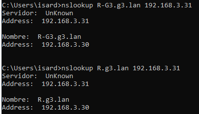

*Figura 18. Resolución de nombres locales desde el equipo Windows.*

> Estas pruebas DNS emplean el servidor `192.168.3.31` de forma explícita. Demuestran que BIND9 responde por la red, pero por sí solas **no prueban** que el cliente haya seleccionado ese DNS automáticamente. Esa comprobación de parámetros DHCP se explica por separado.

---

## 6. Servidor DHCP: instalación y configuración

### 6.1. Instalación del servidor ISC DHCP

Una vez preparado DNS en la misma VM, instalamos `isc-dhcp-server`, el servicio dedicado a asignar direcciones IP automáticamente. Utilizarlo junto con BIND9 evita que dos aplicaciones intenten administrar el puerto 53.

```bash
sudo apt install isc-dhcp-server -y
```

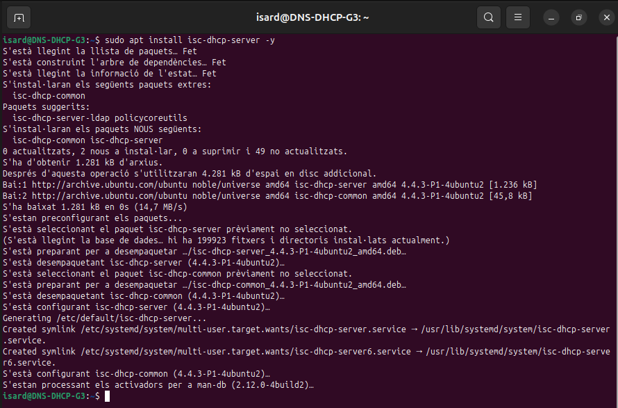

*Figura 19. Instalación del paquete DHCP. Antes de configurar la interfaz y la subred, el servicio puede no iniciarse correctamente.*

### 6.2. Selección de la interfaz interna

El servidor dispone de varias interfaces, pero debe atender las solicitudes DHCP **únicamente en la red interna ITB3**, asociada a `enp2s0`. Por eso configuramos `/etc/default/isc-dhcp-server` con:

```bash
INTERFACESv4="enp2s0"
INTERFACESv6=""
```

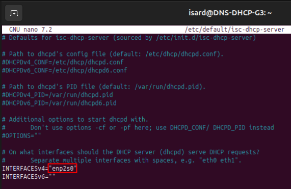

*Figura 20. Selección de `enp2s0` como interfaz IPv4 del servidor DHCP.*

### 6.3. Definición de la pool y de las opciones DHCP

En `/etc/dhcp/dhcpd.conf` definimos una pool de **10 direcciones** entre `192.168.3.50` y `192.168.3.59`, máscara `/24`, gateway `192.168.3.30`, DNS `192.168.3.31` y dominio `g3.lan`.

La parte relevante del archivo es:

```conf
authoritative;
default-lease-time 600;
max-lease-time 7200;

subnet 192.168.3.0 netmask 255.255.255.0 {
    range 192.168.3.50 192.168.3.59;
    option routers 192.168.3.30;
    option domain-name-servers 192.168.3.31;
    option domain-name "g3.lan";
    option subnet-mask 255.255.255.0;
}
```

- `authoritative`: identifica este DHCP como autorizado para la red que administra.
- `range`: limita las direcciones ofrecidas a la pool acordada en el diagrama.
- `option routers`: entrega la puerta de enlace R-G3.
- `option domain-name-servers`: entrega el servidor BIND9 de la propia máquina.
- `default-lease-time` y `max-lease-time`: indican los tiempos de concesión predeterminado y máximo, en segundos.

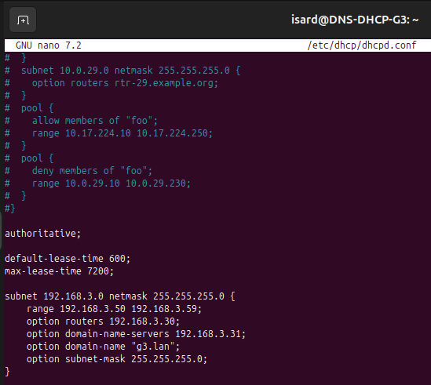

*Figura 21. Configuración del ámbito `192.168.3.0/24` y la pool `.50`–`.59`.*

> **Nota de convivencia:** un servidor DHCP adicional en la misma red de difusión puede generar respuestas contradictorias. Debe comprobarse que el servidor autorizado sea el previsto para ITB3.

---

## 7. Servidor DHCP: comprobaciones y arranque

### 7.1. Validación de la sintaxis

Antes del arranque verificamos el archivo con la herramienta `dhcpd`:

```bash
sudo dhcpd -t -cf /etc/dhcp/dhcpd.conf
```

La salida de la práctica muestra la información del servidor ISC y no muestra errores de sintaxis. Esta comprobación **no equivale todavía a comprobar una concesión real**, pero permite descartar fallos de formato en `dhcpd.conf`.

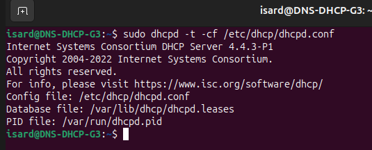

*Figura 22. Comprobación correcta de la sintaxis de `dhcpd.conf`.*

### 7.2. Inicio del servicio y activación persistente

Reiniciamos DHCP para cargar su configuración, consultamos su estado y lo habilitamos para los siguientes arranques:

```bash
sudo systemctl restart isc-dhcp-server
sudo systemctl status isc-dhcp-server
sudo systemctl enable isc-dhcp-server
```

La salida muestra **`active (running)`** y mensajes que indican que el servicio escucha en la red `192.168.3.0/24` a través de `enp2s0`.

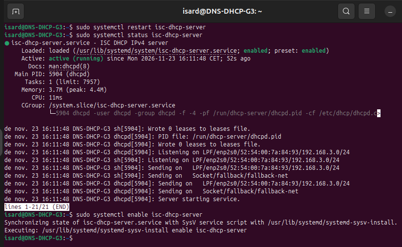

*Figura 23. Verificación del arranque de `dhcpd`, la interfaz de escucha y la habilitación del servicio.*

### 7.3. Verificación del puerto DHCP

Comprobamos el proceso y el socket que utiliza DHCP:

```bash
sudo ss -lunp | grep ':67 '
```

El resultado muestra `dhcpd` a la escucha en `0.0.0.0:67`. La dirección comodín indica el enlace del socket; la interfaz a la que presta servicio se confirma en la configuración y el estado anteriores.

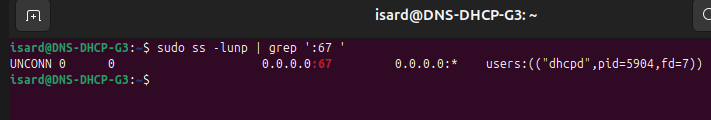

*Figura 24. Proceso `dhcpd` escuchando en el puerto UDP 67.*

---

## 8. Pruebas DHCP desde PC-LIN-G3

### 8.1. Preparación del cliente para obtener una IP automática

El cliente Linux utilizaba inicialmente la dirección estática `192.168.3.21/24`. Para probar DHCP, modificamos su configuración de **Netplan** en `/etc/netplan/50-cloud-init.yaml`, de manera que la interfaz de la red interna `enp2s0` solicitara sus parámetros automáticamente.

La parte relevante quedó configurada de la siguiente forma:

```yaml
network:
  version: 2
  renderer: networkd
  ethernets:
    enp2s0:
      dhcp4: true
      dhcp4-overrides:
        use-routes: false
        use-dns: true
```

Este fragmento representa **solo el bloque que se modificó**: en el fichero completo también figuran las interfaces externas y de VPN. `use-routes: false` indica a Netplan que no instale rutas proporcionadas por DHCP desde `enp2s0` en esa configuración, aunque el servidor sí anuncie la puerta de enlace.

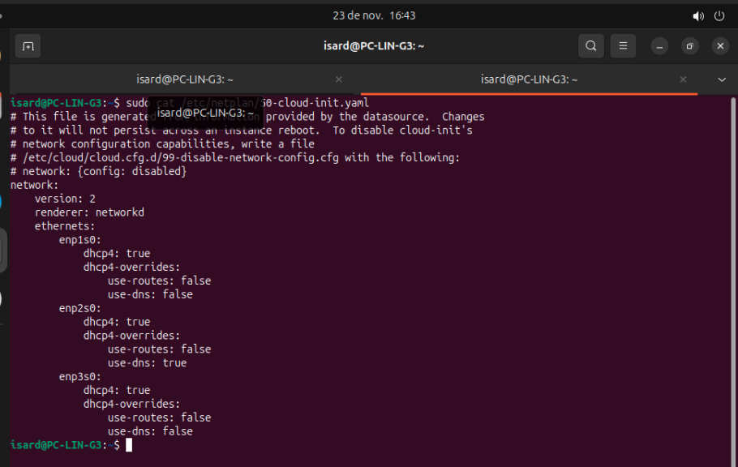

*Figura 25. Configuración de la interfaz del cliente Linux para solicitar una dirección automáticamente.*

### 8.2. Asignación de una dirección de la pool

Aplicamos los cambios y consultamos las direcciones con `ip a` e `ip -br a`. En las pruebas documentadas, el cliente recibió **`192.168.3.50/24`** con la indicación `dynamic`.

```bash
sudo netplan generate
sudo netplan apply
ip -br a
```

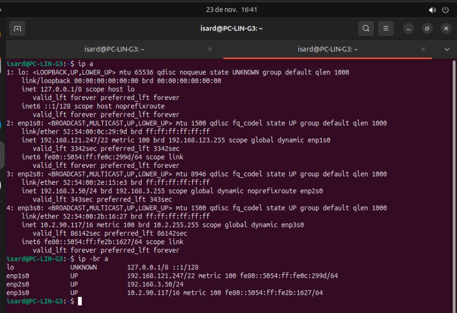

*Figura 26. `PC-LIN-G3` recibe `192.168.3.50/24` en `enp2s0`, dentro de la pool prevista `.50`–`.59`.*

Este resultado constituye la evidencia principal de que el cliente obtuvo una dirección IPv4 automáticamente dentro del ámbito configurado. La captura muestra el estado del cliente; para atribuir con total certeza una concesión concreta al servidor DHCP, la evidencia complementaria sería la entrada correspondiente en `/var/lib/dhcp/dhcpd.leases`.

### 8.3. Verificación de los parámetros recibidos

En una comprobación posterior desde PC-LIN-G3 se consultó la configuración con:

```bash
nmcli -f IP4.ADDRESS,IP4.GATEWAY,IP4.DNS device show enp2s0
```

Se observó lo siguiente:

| Parámetro en el cliente | Valor |
| --- | --- |
| Dirección IPv4 | `192.168.3.50/24` |
| Puerta de enlace anunciada | `192.168.3.30` |
| DNS anunciado | `192.168.3.31` |

**La comprobación se realizó durante la práctica y se mostró en la conversación, pero su captura no aparece en el PDF aportado**. Por ese motivo no se adjunta aquí una figura inexistente. Sería conveniente incorporarla posteriormente para dejar prueba visual del DNS y del gateway entregados junto con la dirección.

### 8.4. Por qué el cliente puede volver a recibir la misma IP

Al reiniciar o renovar una conexión DHCP, el servidor puede entregar de nuevo `192.168.3.50` porque reconoce al cliente y conserva su concesión. Eso **no implica** que solo funcione una dirección de la pool: el rango completo sigue siendo `.50`–`.59`. Para documentar reparto simultáneo a varios equipos, la siguiente prueba apropiada es configurar **PC-WIN-G3** como cliente DHCP y consultar sus parámetros.

---

## 9. Resultados y comprobaciones pendientes

### 9.1. Evidencias aportadas por el Sprint 2

| Comprobación | Resultado documentado |
| --- | --- |
| Instalación y configuración de BIND9 | Archivos de opciones, zona y registros mostrados |
| Validación de DNS | `named-checkconf` sin errores y `named-checkzone` con resultado `OK` |
| Estado DNS | Servicio `named` activo |
| Puerto DNS | `53` en escucha para consultas DNS |
| Resolución local desde el servidor | `R-G3.g3.lan` y `R.g3.lan` → `192.168.3.30` |
| Resolución externa | Consulta de `google.com` con direcciones públicas |
| Resolución desde Linux y Windows | `dig` y `nslookup` contra el DNS interno con resultados correctos |
| Instalación y configuración de ISC DHCP | Pool `192.168.3.50`–`192.168.3.59` en `enp2s0` |
| Validación y arranque DHCP | Archivo correcto, servicio activo y puerto UDP 67 abierto |
| DHCP en cliente Linux | `192.168.3.50/24` asignada dinámicamente |
| Opciones DHCP en cliente Linux | Gateway `.30` y DNS `.31` observados posteriormente; falta incluir su captura en el PDF |

### 9.2. Pruebas adicionales recomendadas

Estas capturas **no constan como evidencias completas en el PDF** y no se deben presentar como realizadas hasta obtener sus resultados:

1. **Concesiones en el servidor DHCP:** `sudo cat /var/lib/dhcp/dhcpd.leases` para mostrar la concesión del cliente, su dirección y su identificador.
2. **Parámetros DHCP del cliente Linux:** `nmcli -f IP4.ADDRESS,IP4.GATEWAY,IP4.DNS device show enp2s0`, con `.50`, `.30` y `.31`.
3. **Asignación a un cliente Windows:** configurar `PC-WIN-G3` para DHCP y mostrar `ipconfig /all`, con una dirección del rango acordado.
4. **Coherencia de DNS tras migrar clientes a DHCP:** revisar los registros A de `PC-LIN-G3` y `PC-WIN-G3`, ya que en el PDF figuran las IP estáticas originales.
5. **Resolución usando el DNS seleccionado automáticamente:** consultar `R-G3.g3.lan` sin indicar manualmente `@192.168.3.31`, para demostrar que el cliente utiliza los parámetros entregados por DHCP.

### 9.3. Conclusión

Las capturas prueban que **BIND9 resuelve nombres de la zona `g3.lan` desde el servidor y desde ambos clientes**, y que también resuelve un dominio externo. Por otro lado, **ISC DHCP Server está activo en `enp2s0`**, escucha en UDP 67 y ha permitido que **PC-LIN-G3 reciba dinámicamente `192.168.3.50/24`**, dentro del rango acordado en el diagrama de red.

Por tanto, la instalación y las pruebas básicas de DNS y DHCP quedan justificadas con evidencias. Para cerrar la validación de ambos servicios de manera más completa, faltaría añadir las capturas de concesiones, opciones DHCP y asignación al cliente Windows, así como revisar los registros DNS de los equipos que han dejado de utilizar IP fija.